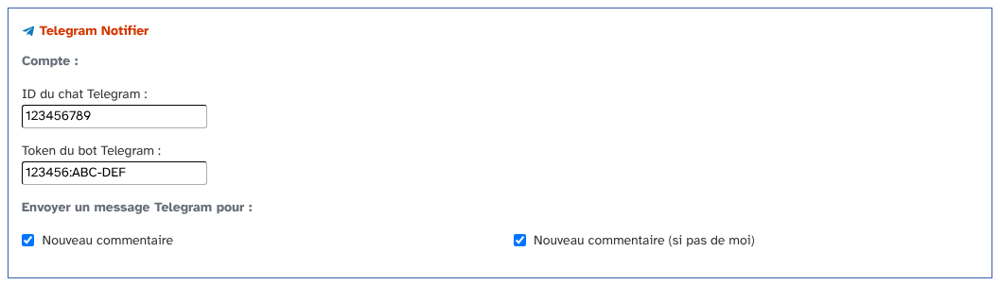

# TelegramNotifier : guide d'utilisation

TelegramNotifier envoie un message Telegram à chaque nouveau commentaire publié sur votre blog. Chaque utilisateur choisit lui-même ce qu'il veut recevoir, depuis ses préférences.

Le plugin n'a pas de page d'administration.

## Sommaire

* [Préparer Telegram](#préparer-telegram)
* [Régler le plugin](#régler-le-plugin)
* [Choisir les messages](#choisir-les-messages)
* [Le message reçu](#le-message-reçu)
* [Bon à savoir](#bon-à-savoir)

## Préparer Telegram

Il faut deux informations, à obtenir dans Telegram :

* le token d'un bot : créez-le avec le bot officiel « BotFather » ;
* l'identifiant numérique du chat qui recevra les messages : c'est le vôtre si vous voulez les recevoir en privé. Écrivez d'abord un message à votre bot, sinon il ne peut pas vous répondre.

## Régler le plugin

1. Ouvrez « Mes préférences » (en haut à droite de l'administration).
2. Allez dans l'onglet « Mes options ».
3. Repérez le cadre « Telegram Notifier ».
4. Saisissez « ID du chat Telegram » et « Token du bot Telegram ».
5. Enregistrez avec le bouton en bas de la page.

À l'enregistrement, le plugin interroge Telegram pour vérifier ces valeurs. Si Telegram refuse, le message « Impossible de configurer Telegram » s'affiche et les valeurs ne sont pas gardées.

Chaque utilisateur du blog a ses propres valeurs.

## Choisir les messages

Les cases n'apparaissent qu'une fois l'ID et le token enregistrés. Il faut donc enregistrer deux fois : d'abord le compte, puis les messages.

Sous « Envoyer un message Telegram pour », cochez ce que vous voulez recevoir :

* « Nouveau commentaire » : tous les nouveaux commentaires ;
* « Nouveau commentaire (si pas de moi) » : seulement ceux dont l'adresse e-mail n'est pas la vôtre (ni l'une des adresses de votre profil).

Si vous cochez les deux, vous recevrez deux messages par commentaire.

Les messages envoyés sont réservés aux utilisateurs qui ont une permission de gestion sur le blog (utilisation, publication, suppression ou administration du contenu), ou aux administrateurs.

## Le message reçu

Le message contient :

* le titre « Nouveau commentaire » ;
* le nom du blog ;
* l'entrée commentée, avec un lien ;
* l'auteur du commentaire et son adresse e-mail.

Le texte du commentaire n'est pas envoyé. Les commentaires classés indésirables ne déclenchent rien.

## Bon à savoir

* Le token donne le contrôle du bot : ne le partagez pas.
* Un message qui n'a pas pu partir n'est pas signalé : aucun message d'erreur ni journal. Le mode debug de Dotclear affiche l'erreur.
* Seuls les commentaires créés depuis le site public déclenchent un message.
* Le plugin peut être étendu pour d'autres messages : voir le README.
